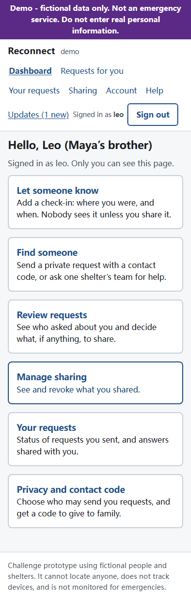
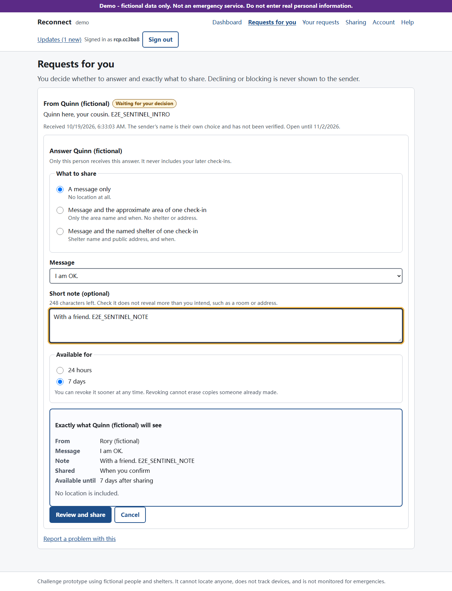
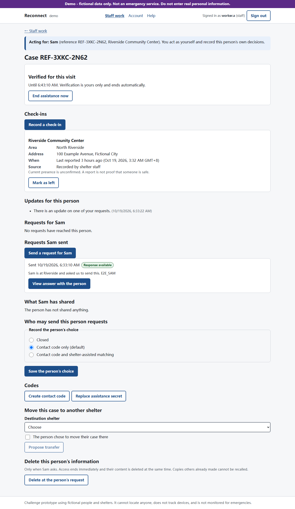

# Reconnect: private, consent-based family reunification (challenge prototype)

A small full-stack website for the hurricane scenario in the challenge brief (`Full stack challenge.pdf`, not included in the repository until its publication is approved). People who were separated can leave historical check-ins, send private requests, and decide exactly what to share with one specific person. Shelter staff can do all of this on behalf of someone who has no phone, account or ID.

**Demo with fictional data only. Not an emergency service.**

## Status

| Item | State |
| --- | --- |
| Phases 00–06 (app, security, lifecycle, benchmarks) | Implemented and tested locally; evidence in [docs/progress.md](docs/progress.md) |
| Acceptance catalog | 59 of 63 IDs covered by passing automated tests or recorded evidence; see [docs/test-traceability.md](docs/test-traceability.md) |
| Live deployed link | **Not deployed.** Render's free tier was chosen: `render.yaml` runs one free web service (migrations, one-time fictional seed and worker in one process) with a free PostgreSQL that expires after 30 days. It needs a public repository and a Render account |
| Public repository link | **Not created.** One local commit on `main`; no remote, nothing pushed |
| Accessibility | Automated checks, keyboard journeys and a real 200% browser-zoom audit pass. Screen-reader walkthrough done by the owner with open details ([record](docs/screen-reader-walkthrough.md)) |
| Shelter use without devices | Tested automatically end to end (intake, paper contact code, no-code matching across two shelters) and walked through by the owner ([steps](docs/shelter-walkthrough.md)) |

## The story it supports

1. Sam reaches Riverside shelter with no phone. A worker records an intake (alias only), a check-in, and gives Sam a reference card plus a separate private assistance secret.
2. Leo, Sam's relative, registers on his own with a username, password and alias. He records that he is at Hillcrest School Gym.
3. Sam (through the worker) sends Leo a private request using the contact code Leo gave the family. Nobody learns whether the code matched anyone.
4. Leo chooses what to share: a message only, the approximate area of one check-in, or the named shelter of one check-in, for 24 hours or 7 days. He sees an exact preview first.
5. Only Sam's verified case team can open that answer with Sam. Any other account, worker or URL gets the same "not found".
6. Leo revokes the share. The next read fails everywhere.

Without a contact code, a requester can ask one chosen shelter's team for help. A worker there compares the clues only with people at that shelter who opted into assisted matching, and proposes a match for that person's own decision. The requester never sees candidates or learns the outcome.

## People and what the site does for them

| Who | Need | What the site provides |
| --- | --- | --- |
| Person with a phone | Be findable on their own terms | Account with alias, historical check-ins, contact code, inbox, per-person sharing, revoke |
| Person who wants privacy | Search without revealing themselves | No location required; incoming requests can be closed; requesters learn nothing unless answered |
| Person without phone or ID | Take part at all | Staff-assisted intake, check-ins, requests and answers; private assistance secret for repeat visits |
| Shelter worker | Help quickly without overreach | Assigned cases only, short verified sessions, intake in 3 primary steps, matching limited to opted-in local people |
| Shelter coordinator | Allocate work, hand over cases | Minimal case index (no names), assignment, routed-request queue, transfers, review and closure |
| Child or person unable to consent | Safeguarding | Restricted referral record only: no location, requests, matching or sharing |

## What is deliberately not built

No GPS or live location, no public people directory or search, no automatic family access, no automatic identity or guardian verification, no automatic record merging, no SMS/email, no maps, no chat or attachments, no broadcast matching across shelters. These are listed with reasons in [design.md](design.md).

## How it fits a larger system

A real deployment would sit alongside agencies that already restore family links (for example national Red Cross tracing services). This prototype covers the narrow, privacy-critical core: consented routing and disclosure. The surrounding system would need partner agreements, trained and vetted staff, a safeguarding referral process for children, multilingual support, offline/paper procedures (outlined in [design.md](design.md#connectivity-and-paper-fallback)), and operations staff for credential recovery.

## Key design decisions and tradeoffs

- **Privacy over findability.** A person is only reachable through their contact code or an opted-in shelter case. This means some searches never succeed; the site says "No response available yet" rather than revealing anything.
- **Uniform outcomes.** Valid, unknown, rotated, closed and blocked codes all return the same `202`, and declined or blocked requests look exactly like unanswered ones until the original 14-day deadline.
- **History, not location.** A check-in is "last reported" with time, timezone and source. Superseding a shared report marks it "no longer current" without revealing the new place.
- **Grants are narrow.** One response, one recipient, one check-in at most, 24 h or 7 days, revocable. Later check-ins never follow.
- **Staff act as themselves.** Staff need TOTP two-step verification, an active assignment on the case at their current shelter, and a 10-minute verification of the person's own secret before any sensitive assisted action. Coordinators allocate work without seeing person content.
- **Defense in depth in the database.** Composite foreign keys guarantee that a response's subject is the request's recipient, the grant goes to the requester, a disclosed check-in belongs to the subject, and staff assignments stay inside one incident.
- **Reliability.** Idempotency keys on every critical write, row locks for approve/withdraw/block races, a database outbox with leases and bounded retries that rechecks authority at delivery.
- **Cost of these choices.** More steps for staff, no "found" confirmation for anxious families, and requests that can stay unresolved when nobody has a lead.

## Architecture

```text
Browser (React + Vite, same origin)
   -> Express API: session cookie -> origin/CSRF check -> zod validation -> policy -> domain service -> explicit serializer
   -> PostgreSQL 17 (Prisma migrations + hand-written constraints)
   <- outbox worker (separate process): claim with lease -> recheck authority -> generic notification
```

TypeScript monorepo: `apps/api`, `apps/web`, `packages/contracts` (shared zod schemas and types), `prisma/` (schema, migrations, fictional seed), `tests/` (unit, integration, security, e2e), `scripts/` (verify, e2e runner, operator CLIs, performance).

Security details: Argon2id passwords; opaque session tokens stored as HMAC digests; HttpOnly, SameSite=Lax, `__Host-` + Secure cookies on HTTPS; 30 min idle / 12 h absolute sessions (staff 15 min / 8 h); polling never extends idle time; AES-256-GCM application encryption with versioned keys for introductions, clues, messages, matching clues and TOTP secrets; purpose-separated HMAC digests for codes and secrets; strict CSP; metadata-only logs and audit. See [docs/security-and-permissions.md](docs/security-and-permissions.md).

## Screenshots (fictional data)

| Mobile dashboard | Answer preview before sharing | Staff case workspace |
| --- | --- | --- |
|  |  |  |

More at 390, 768 and 1280 px in [evidence/screenshots](evidence/screenshots).

## Local setup

Requirements: Node 24.22.0 (`.nvmrc`; any 24.x from 24.11 works), npm 11, Docker (for PostgreSQL) or any disposable PostgreSQL 17 server.

```bash
npm ci
npm run setup:env        # creates .env with random local keys (never overwrites)
npm run db:up            # PostgreSQL 17 on 127.0.0.1:55432 via docker compose
npm run db:migrate       # applies committed migrations; never resets
npm run db:seed          # fictional fixtures; idempotent; refuses non-demo environments
npm run dev              # API :3000, web :5173 (open http://localhost:5173), worker
```

Production-style run: `npm run build`, then `npm run start` and `npm run worker` in two terminals.

Demo accounts (local seed): individuals `maya`, `leo`, `noor`, `evan`; staff `worker.a`, `worker.a2`, `worker.b`, `coord.a`, `coord.b`, `operator.o`. The password is the `SEED_PASSWORD` value in your `.env`. Staff set up an authenticator app on first sign-in. Assisted people (Sam, Ana and others) have assistance secrets derived from `SEED_SECRET`; for a walkthrough, create a new intake from a worker account and use the secret it shows.

Operator tools: `npm run staff:admin -- provision --username u --role WORKER --shelter "Riverside Community Center" --confirm`, and `npm run ops -- retention | reencrypt | ledger-export --out f | ledger-replay --in f`.

## Tests and evidence

```bash
npm run verify             # docs, lint, types, build, unit, integration, security, e2e, accessibility
npm run test:performance   # PERF-01..03 benchmark (needs a build); writes evidence/performance/perf-summary.json
npm run test:performance -- --single-process   # same, against the free-hosting start command
npm run audit:zoom         # real 200% Chromium page zoom over 40 views; writes evidence/zoom-200/
npm run check:free-start   # free-hosting rehearsal: start, smoke, delete, restart
npm run drill:restore      # restore drill through the operator CLI on disposable databases
npm run smoke:deployed -- --base-url https://host   # non-destructive deployed smoke
```

Integration and security tests use real disposable PostgreSQL databases named `rf_test_*` on `TEST_DATABASE_ADMIN_URL` (defaults to the local Docker server). Browser tests run Playwright against the production build, the worker and a disposable database, with separate browser contexts per person.

Latest local results (2026-10-19, Node 24.22.0, final `npm run verify` run 6): 26 unit, 99 integration, 14 security, 27 browser and 5 accessibility tests passing, no skips. All 11 performance gates passed in both modes on a 10,000-person synthetic dataset with 20 clients: p95 68 ms over 29,939 operations with the in-process harness, and p95 62 ms over 34,473 operations against the single-process free-hosting start; delivery p95 about 1.1 s, login p95 under 55 ms, 96 KiB initial JS, median throttled mobile LCP 1.2 s. These are laptop results, not hosted measurements. The restore drill passed 11/11 and the free-hosting rehearsal 8/8. The 200% zoom audit covered 40 views and found two defects, both fixed with regression tests. Older runs, including a failed one, are kept in `evidence/verify-2026-10-19/` (home-directory paths replaced with `~`). Exact commands, environment and failures are in [docs/progress.md](docs/progress.md); current versus older evidence and the lifecycle status (recovery, transfers, deletion, purge, expiry, restore) are in [docs/test-traceability.md](docs/test-traceability.md).

## Deployment

The `Dockerfile` builds one image with three commands: web (`node apps/api/dist/server.js`), worker (`node apps/api/dist/worker.js`) and release (`node node_modules/prisma/build/index.js migrate deploy`). It was built on `node:24.22.0-bookworm-slim` and started locally against a disposable PostgreSQL database with production settings. The chosen free setup, its limits, the paid upgrade path and the steps are in [docs/deployment.md](docs/deployment.md). The free Blueprint is [render.yaml](render.yaml); `npm run check:free-start` rehearses its single-process start locally. A live URL still requires a public repository (the owner chooses its name and who pushes) and a Render account.

## Known limitations

- Not deployed; no public repository yet (one local commit).
- On the chosen free host, scheduled clean-up (for example request text 30 days after closure) runs only while the service is awake, so those retention windows can run late. Deletion purges immediately, and expiry and revocation are checked on every read.
- Login proves control of an account, not identity. Staff-recorded consent is witnessed, not provable.
- A lost assistance secret only opens a manual escalation; there is no automated recovery for assisted people.
- Requests without a lead, or to shelters without staff, stay unresolved by design.
- Revocation stops future reads; it cannot erase screenshots or copies.
- Operators who hold database and key access are trusted. Database volume and backup encryption depend on the host.
- Performance numbers come from one Windows laptop with a local database; they do not show regional-scale capacity.
- Automated accessibility checks and a real 200% zoom audit (Chromium only) passed, but the screen-reader check is still pending. English only.

## How AI was used

This implementation was written by Claude Code (an AI coding agent) following the planning documents in `docs/` and the rules in `AGENTS.md`/`CLAUDE.md`. The planning documents predate the implementation; the owner should state which tools helped write them. The human owner set the product rules and scope. Output was verified by running it, not by trusting it: every acceptance ID maps to a test that was executed against real PostgreSQL and a real browser; several authorization tests were mutation-checked by deliberately removing a policy check and confirming the test failed; test mistakes found along the way are recorded in the progress log rather than hidden. Claims in this README are limited to what those runs showed.
