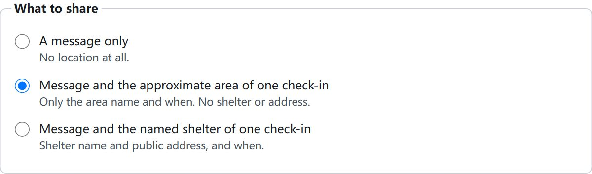
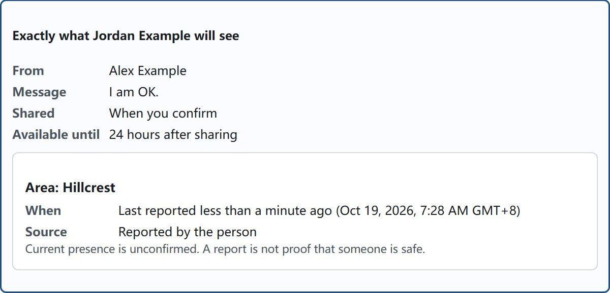
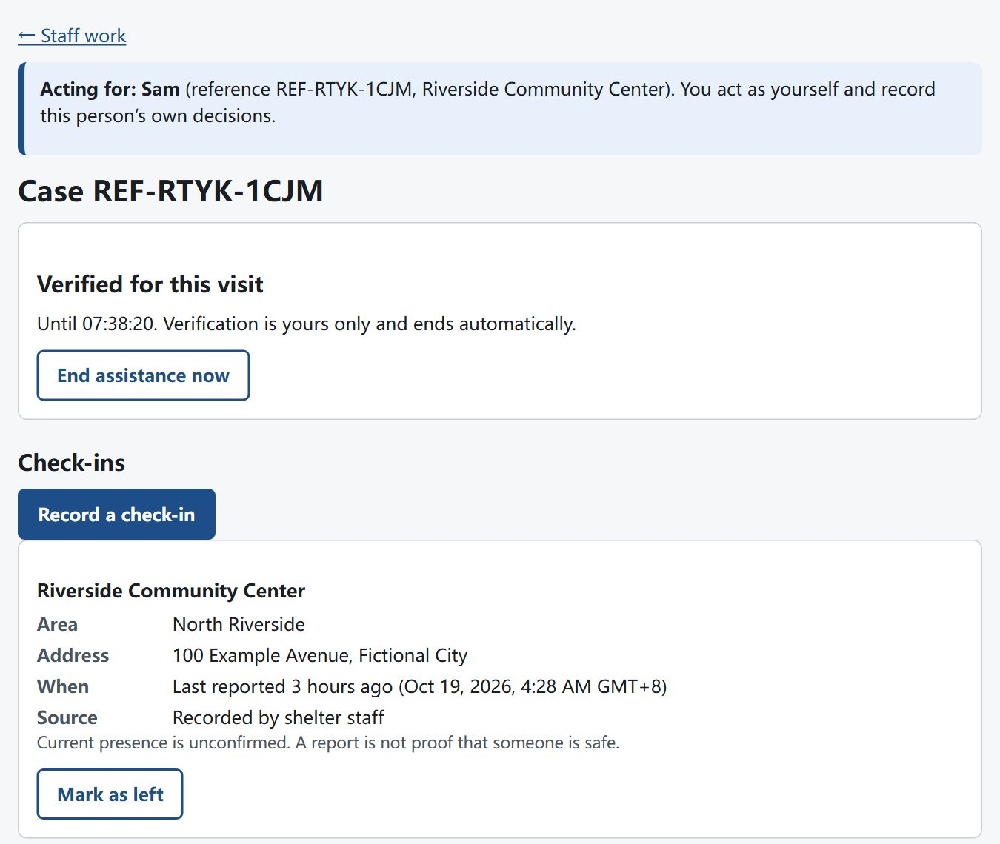
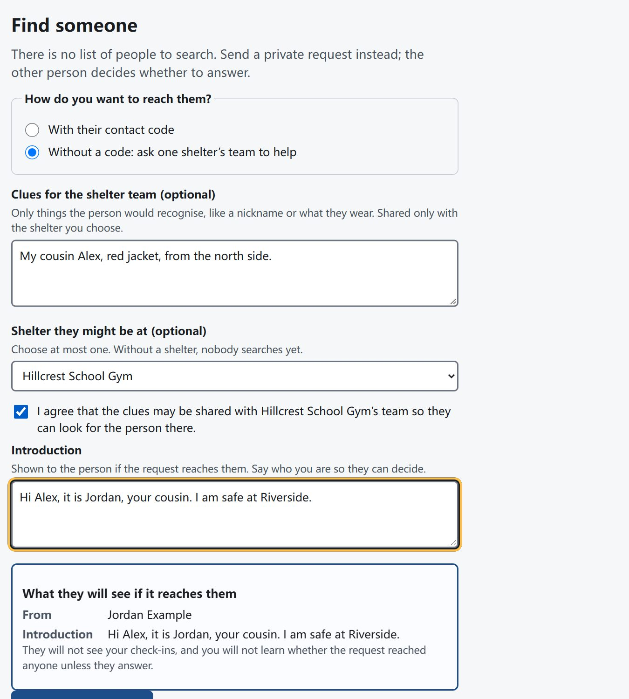
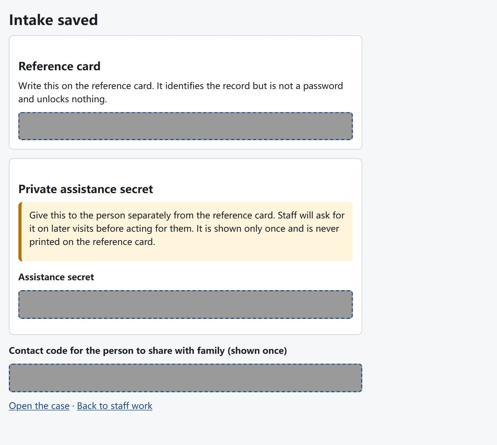

# Reconnect: private, consent-based family reunification

**Deployed link: [https://reconnect-web.onrender.com](https://reconnect-web.onrender.com)**

A full-stack web app for the hurricane scenario in the challenge brief: people separated in an evacuation leave historical check-ins, send private requests, and decide exactly what to share with one specific person. Shelter staff can do all of this with someone who has no phone, account or ID.

**Demo with fictional data only. Not an emergency service.**

| | |
| --- | --- |
| **Live demo** | **<https://reconnect-web.onrender.com>** (free hosting: after 15 quiet minutes the first page takes about a minute to wake) |
| **Repository** | <https://github.com/COMPRyanLI/Reuniting-Separated-Families> |
| **User manual (PDF)** | [docs/Reconnect-user-manual.pdf](docs/Reconnect-user-manual.pdf): for people with a phone, people without one, shelter staff, and operators |
| **Design and tradeoffs** | [docs/design-and-tradeoffs.md](docs/design-and-tradeoffs.md) |

## Overview

Try it in two browser windows (one normal, one private): create two accounts, add a check-in in one, create a contact code under **Privacy and contact code**, send a request from the other with that code, then answer it and choose what to share. The [user manual](docs/Reconnect-user-manual.pdf) shows every step.

| Answering: choose what to share | Exact preview before sharing | Staff case page for a person without a phone |
| --- | --- | --- |
|  |  |  |

| Mobile dashboard | Looking for someone without a code | Staff intake result (secrets hidden) |
| --- | --- | --- |
|  |  |  |

All screenshots use fictional data; secrets are masked.

## The full picture

**What I built and why.** The most dangerous part of reunification is not search but **disclosure**: a list anyone can search would also help an abusive partner or an informant find someone who fled. So I built the consented core end to end: a request reaches the right person, and that person alone decides what, if anything, to reveal, to one recipient, for a limited time. It works with or without a phone, through shelter staff.

**The story it supports.**

1. Sam reaches Riverside shelter with no phone. A worker records an intake (any name, no ID), a check-in, and gives Sam a reference card plus a separate private assistance secret, and a contact code for family.
2. Leo, Sam's relative, signs up on his own phone with a username, password and nickname, and records that he is at Hillcrest School Gym.
3. Sam, through the worker, sends Leo a private request with the code Leo gave the family. Nobody learns whether the code matched anyone.
4. Leo chooses what to share: a message only, the approximate area of one check-in, or the named shelter of one check-in, for 24 hours or 7 days. He sees an exact preview first.
5. Only Sam's case worker, during a visit verified with Sam's secret, can open that answer with Sam. Any other account, worker or link gets the same "not found".
6. Leo can revoke the share at any time; the next read fails everywhere.

Without a contact code, a requester asks **one** shelter's team for help. A worker there compares the clues only with people at that shelter who opted into assisted matching and proposes one person, who decides. The requester never sees candidates or learns the outcome.

**How the parts I did not build would work** (details in [design-and-tradeoffs.md](docs/design-and-tradeoffs.md#4-how-the-rest-of-the-system-would-work)): paper-only shelters use a one-page form keyed in later as staff-recorded check-ins; existing tracing services (such as national Red Cross family-links services) send requests through the same consented route; a phone hotline works like a shelter desk; SMS carries only "you have an update"; child reunification and identity checks go to trained safeguarding staff through restricted referrals; duplicates are flagged for staff, never merged automatically.

**Where this piece fits.** It is the privacy-critical layer between people, shelters and tracing agencies: whatever other channel finds a lead, the person being looked for still decides what is revealed.

## Design

**Users.**

| Who | Need | What the app provides |
| --- | --- | --- |
| Person with a phone | Be findable on their own terms; ask after others | Alias account, historical check-ins, contact code, requests, per-person sharing, revoke |
| Person without phone or ID | Take part at all | Staff-assisted intake, check-ins, requests and answers; private assistance secret on paper |
| Person who does not want to be found | Search without exposure | No public list or search; incoming requests can be closed; decline and block are never revealed |
| Shelter worker or volunteer | Help quickly without overreach | Assigned cases only, two-step sign-in, 10-minute verified visits, 3-step intake, matching only among opted-in people |
| Shelter coordinator | Allocate work, move cases | Assign matching tasks and staff, transfers and case reviews, without reading case content |
| Child or person unable to consent | Protection | Restricted referral only: no location, requests, matching or sharing |

**Which part and why:** see "The full picture" above.

**Edge cases considered** (full table in [design-and-tradeoffs.md](docs/design-and-tradeoffs.md#5-edge-cases-and-how-they-are-handled)): no phone or ID; an abusive partner probing for someone; people afraid to give a real name; someone claiming to be family; a code given to the wrong person; out-of-date locations; screenshots of shared data; lost passwords and lost assistance secrets; children; shared shelter computers; worker overreach; requests sent to the wrong shelter; deletion and restored backups; network failures mid-form.

**Deliberately not built:** live location or GPS, a people directory or search, automatic family access, identity or guardian verification, automatic record merging, SMS or email, maps, chat or attachments.

## Technical choices

- **Stack:** TypeScript end to end. React 19 + Vite web app, Node.js 24 + Express 5 API serving the built app from the same origin, PostgreSQL 17 with Prisma migrations plus hand-written constraints, zod schemas shared by client and server. One backend, one database, and a database outbox for background delivery (no Redis or queue to secure).
- **Why:** few moving parts, each well understood; relational constraints make some privacy bugs impossible (a share cannot reference a check-in that is not the answerer's); everything deploys as one free web service.
- **Security:** Argon2id passwords; server-side sessions in `__Host-`, Secure, HttpOnly, SameSite cookies; CSRF token plus origin check on every change; strict Content Security Policy; HMAC digests for codes and secrets; AES-256-GCM for private text; identical responses for every routing outcome; metadata-only logs. See [security-and-permissions.md](docs/security-and-permissions.md).
- **Biggest tradeoff: privacy over findability.** Nobody is told "we found them" unless that person chose to answer, and there is no name search. Some families will wait longer or never connect through this tool. I accepted that because a wrong disclosure cannot be undone while a slow reunion can still happen another way. The reasoning, and how the cost is reduced, is in [design-and-tradeoffs.md](docs/design-and-tradeoffs.md#7-the-biggest-tradeoff-privacy-over-findability).
- **Hosting tradeoff:** the free Render tier runs the website, API and background worker in one process with a free database. It sleeps after 15 idle minutes (the worker sleeps too), the free database expires 30 days after creation, has no backups, and scheduled clean-up only runs while awake (deletion itself purges immediately). The paid two-process setup is ready in [deploy/render.paid.yaml](deploy/render.paid.yaml).

```text
Browser (React, same origin)
  -> Express API: session cookie -> origin + CSRF check -> zod validation -> permission policy -> domain service -> explicit response fields
  -> PostgreSQL 17 (migrations + constraints)
  <- outbox worker (in the web process on the free host): claim with lease -> recheck permission -> generic notification
```

Repository layout: `apps/api`, `apps/web`, `packages/contracts`, `prisma/` (schema, migrations, fictional seed), `tests/` (unit, integration, security, e2e, hosted), `scripts/` (verification, operator tools, audits), `docs/`.

## Testing and evidence

| Where | What ran | Result |
| --- | --- | --- |
| Live site (2026-10-19) | `npm run smoke:deployed` against the live URL | 15/15 ([log](evidence/hosted-2026-10-19/smoke-deployed.log)) |
| Live site (2026-10-19) | `npm run test:hosted`: two people and an outsider in separate browsers; sign-up, check-in, contact code, request, exact preview, answer, outsider denied, revoke; CSRF and foreign-origin refusal; shared-device sign-out and Back; password recovery; accessibility scans and phone-width layout; account deletion | 8/8 ([log](evidence/hosted-2026-10-19/hosted-browser.log)); fictional test accounts deleted afterwards |
| Live site (2026-10-19) | Security headers, HTTP to HTTPS, deep links, 404 handling | HSTS, CSP, frame blocking, no-referrer, no `X-Powered-By`; HTTP redirects to HTTPS |
| Live site (2026-10-19) | Restart: idle until Render put the service to sleep, then wake | Passed: after 18 idle minutes the first request took 32.6 s (Render woke a new server process); a fictional marker account created before the sleep still signed in and its check-in was still there ([result](evidence/hosted-2026-10-19/restart-persistence.json)); marker deleted afterwards |
| Local, Node 24.22.0 | `npm run verify` (docs, lint, types, build, unit, integration on real PostgreSQL, security, browser, accessibility) | unit 26, integration 102, security 14, browser 28, accessibility 7; no skips |
| Local | Performance benchmark, 10,000-person synthetic dataset, 20 clients, both hosting modes | all 11 gates passed (p95 62–68 ms); laptop results, not hosted |
| Local | Real 200% browser zoom over 40 views; restore drill; free-hosting rehearsal | 0 findings after 2 fixes; 11/11; 8/8 |
| People | Screen-reader walkthrough and shelter walkthrough by the owner | done; open details recorded in [docs](docs/screen-reader-walkthrough.md) |

Every acceptance ID is mapped to its test in [docs/test-traceability.md](docs/test-traceability.md); the full handoff log with commands, failures and fixes is [docs/progress.md](docs/progress.md).

## Running it locally

Requirements: Node 24.22.0 (`.nvmrc`; any 24.x from 24.11 works), npm 11, Docker (for PostgreSQL) or any disposable PostgreSQL 17.

```bash
npm ci
npm run setup:env        # creates .env with random local keys (never overwrites)
npm run db:up            # PostgreSQL 17 on 127.0.0.1:55432 via docker compose
npm run db:migrate       # applies committed migrations; never resets
npm run db:seed          # fictional demo data; refuses non-demo environments
npm run dev              # open http://localhost:5173
```

Demo accounts: people `maya`, `leo`, `noor`, `evan`; staff `worker.a`, `worker.a2`, `coord.a` (Riverside), `worker.b`, `coord.b` (Hillcrest). The password is `SEED_PASSWORD` in your `.env`. Staff set up an authenticator app on first sign-in. Creating staff accounts: `npm run staff:admin -- provision --username NAME --role WORKER --shelter "Riverside Community Center" --confirm` (see the manual, Part 4).

Deployment: [docs/deployment.md](docs/deployment.md) ([render.yaml](render.yaml) is applied as a Render Blueprint; no secrets need to be typed).

## Known limitations

- Free hosting: sleeps after 15 idle minutes; the free database is deleted 30 days after creation unless upgraded; no backups; scheduled clean-up runs late while asleep.
- On the hosted demo, new staff accounts cannot be added without a deliberate change (no shell, database closed to outside connections); demo staff accounts exist. Each staff account's two-step setup belongs to whoever completes it first.
- Per-IP sign-in and registration limits rely on the client address the host forwards; with Cloudflare in front of Render this was not independently verified.
- Signing in proves control of an account, not identity. Staff-recorded consent is witnessed, not provable.
- Requests without a good lead stay unanswered by design. Revocation cannot erase copies or screenshots.
- Performance was measured on one laptop with a local database, not on the host or at regional scale.
- English only. Screen-reader check done by the owner with open details (see its record).

## How AI was used

- **My decisions (the owner):** I decided the user classifications, specified which detailed portion of the functionality to concentrate on, and made all the tradeoff decisions. I wrote the detailed implementation plans (the Markdown files in `docs/`, including the phase plans and the acceptance catalog) and the detailed harness metrics the agents used to build, test and improve the product.
- **Claude Code (Claude Opus 5.5)** developed the product from those plans: implementation, tests, fixes, deployment preparation and documentation.
- **OpenAI Codex (GPT Astra)** was used for debugging and for Playwright testing of the frontend.
- **My own review:** I personally went through all the key code, and ran the screen-reader and shelter walkthroughs myself.
- **How the output was checked:** nothing was accepted on trust. Every acceptance ID maps to a test that ran against real PostgreSQL and real browsers; several authorization tests were checked by removing a policy check and confirming the test failed; failures and test mistakes are recorded in [docs/progress.md](docs/progress.md) instead of hidden.
