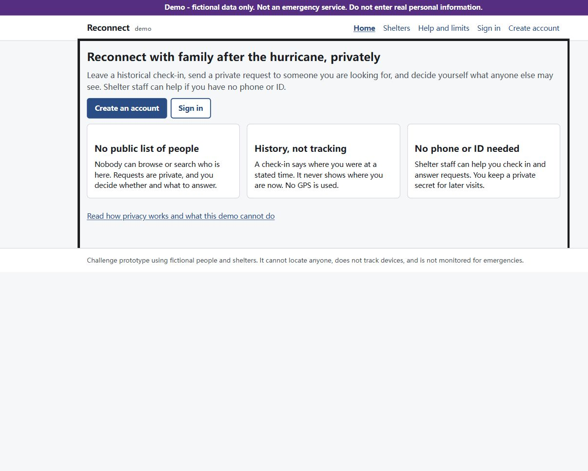

# Screen-reader walkthrough (human check)

Status: **WALKTHROUGH FINISHED WITH OPEN DETAILS** – human confirmations recorded through step 12. Step 2 spoken feedback, the brief shelter-loading announcement, and whether request success was automatically announced remain unconfirmed. Screen-reader name/version also needs recording. This is not an unconditional accessibility pass. Automated accessibility tests do not replace human listening.

Purpose: confirm that a screen-reader user can find their way around, sign in, understand form labels and errors, add a check-in, send and answer a request, choose what to disclose, revoke a share and sign out. Use fictional names only.

## Setup

- Windows 11, Microsoft Edge (best with Narrator) or Firefox/Chrome (NVDA).
- Start the app with `npm run dev` and open `http://localhost:5173`. Use new accounts you create in step 4 and 8; this adds fictional rows to the development database but does not reset it.
- Narrator: Ctrl+Win+Enter turns it on and off; Caps Lock+Space toggles scan mode. In scan mode: H next heading, D next landmark, K next link, F next form field, B next button. Caps Lock+T reads the page title. Ctrl stops speech.
- NVDA equivalents: Insert+Space toggles browse/focus mode; H, D, K, F, B as above; Insert+T reads the title.
- Wording differs between screen readers and browsers. Judge whether the meaning is conveyed, not the exact words.

## Steps

| # | Action | Expected (approximately) |
| --- | --- | --- |
| 1 | Load the home page. Read the title. | Title "Home - Reconnect (demo)". Reading starts with the demo notice "Demo - fictional data only…". |
| 2 | Press Tab once, then Enter. | "Skip to main content, link". Enter moves you to the main content. |
| 3 | Scan mode: press D repeatedly, then H repeatedly. | Landmarks: banner, "Main" navigation, main, content information. Headings: level 1 "Reconnect with family after the hurricane, privately", then level 2 card headings. |
| 4 | Tab to "Create account" and activate it. On the form, press "Create account" without filling anything. Then Tab back to Username. | New page announced ("Create an account"). Each field reads its label and hint, e.g. "Username, edit, Used only to sign in…". After the empty submit, focus jumps to an alert "There is a problem… Some fields need attention" with the list of problems. Username then reads as invalid with "Error: …". |
| 5 | Fill in Username, Password and "Name others will see" (fictional), submit. Find the recovery secret, tick "I have written down my recovery secret", Continue. | Recovery secret readable as text. Checkbox announced with its label and state. Dashboard heading announced after Continue. |
| 6 | Go to "Your check-ins", activate "Add a check-in". Save without choosing a shelter. Then choose a shelter and save. | Radio group "Where were you?" with "At a shelter, 1 of 2". "Shelter, combo box". While the list loads: "Loading the shelter list…". Empty save gives an error you can find. After saving, you can tell the check-in was saved. |
| 7 | Go to "Privacy and contact code", activate "Create contact code". Note the code, then "I noted it, hide it". Sign out. | Code read as text under "Your contact code (shown once)". "Sign out" leads to a "Signed out" page; the title changes. |
| 8 | Create a second fictional account (repeat step 4–5 quickly). Go to "Find someone". Send once empty, then enter the contact code and an introduction and send. | Radio group "How do you want to reach them?". "Contact code, edit, 26 letters and numbers…". Empty send: alert with "Enter the contact code." and the introduction error. Region "What they will see if it reaches them" readable. After sending: heading "Request saved". Sign out. |
| 9 | Sign in as the first account. Go to "Requests for you", find the request, activate "Answer". | Card heading "From <second alias>" and status "Waiting for your decision". Answer form: group "What to share" with three choices and their descriptions read with each radio button. |
| 10 | Choose "Message and the approximate area of one check-in", pick the check-in, choose 24 hours, read the preview, then "Review and share" and confirm. | "Which check-in, combo box". Region "Exactly what <alias> will see" lists From, Message, Area and time, with "Current presence is unconfirmed…". After "Review and share": "Check the preview above, then confirm." The confirm button names the recipient. |
| 11 | Go to "Sharing" ("Manage sharing"). Activate "Revoke everything shared", listen, choose Cancel. Then activate "Revoke" on the share. | The confirmation is announced as an alert dialog "Confirm revoke all" with its warning text and Revoke all / Cancel buttons. After Revoke, the share shows as revoked. |
| 12 | Activate "Sign out". Then press the browser Back button. | "Signed out" page announced. Going back does not read any private content (you are asked to sign in instead). |

## Observations (fill in)

| # | Result (OK / Problem) | What you heard or what was missing |
| --- | --- | --- |
| 1 | OK (human report) | Tester reported “Step1 ok” and subsequently confirmed action 1 is OK. |
| 2 | Observation; listening result pending | Tester reports Tab reveals “Skip to main content”; activating it appears to change nothing except a bold rectangular outline around the content. Tester questions its usefulness because pages have little content. Exact spoken announcement after activation was not reported. |
| 3 | OK (human report) | Tester reported “step 3 Ok” after the landmark and heading navigation instructions. |
| 4 | OK (human report) | Tester confirmed “labels ok”, then “step 4 ok” after the empty-form error-summary and invalid Username checks. [Screenshot](../evidence/screen-reader/step-04-empty-form.jpg). |
| 5 | OK (human report) | Tester reported “step5 ok” after recovery-secret readability, checkbox label/state, Continue and dashboard announcement checks. Fictional Alex Demo account created locally; credentials omitted from this report. |
| 6 | OK for assessed checks (human report) | Tester confirmed “check-in labels ok”, then “Both OK” for the missing-shelter error and recognition of the saved Hillcrest check-in. New empty form cancelled without saving a second report. Loading announcement was not assessed because the list loaded quickly. [Screenshot](../evidence/screen-reader/step-06-missing-shelter.jpg). |
| 7 | OK (human report) | Tester confirmed contact-code check, then explicitly confirmed hearing sign-out after the agent hid the code and signed out. Title became “Signed out - Reconnect (demo)” with main focused. [Screenshot](../evidence/screen-reader/step-07-signed-out.jpg). |
| 8 | In progress | Tester confirmed “Request labels OK” for the reach-method choices, contact code hint, introduction and preview. Empty submission displayed “Not sent”, “Enter the contact code.” and the introduction error, with focus on the summary. Tester confirmed “Request errors OK”. Tester later confirmed the request was saved successfully; whether the success heading was automatically announced remains unspecified. [Screenshot](../evidence/screen-reader/step-08-empty-request.jpg). |
| 9 | OK (human report) | Tester confirmed incoming card, then “Preview OK” after the agent opened Answer and requested checks of the What to share group and all three descriptions. |
| 10 | OK (human report) | Tester confirmed “Preview OK” for disclosure descriptions, area/time, 24-hour availability, disclaimer, review instruction and recipient-named confirmation button. Agent then activated confirmation for the fictional response. [Screenshot](../evidence/screen-reader/step-10-preview.jpg). |
| 11 | OK (human report) | Tester confirmed “Dialog OK” for revoke-all name, warning and buttons. Agent cancelled it, then revoked the individual share with Jamie; UI reads “Shared with Jamie Demo Revoked”. Tester confirmed “Revoked status OK”. [Dialog](../evidence/screen-reader/step-11-revoke-dialog.jpg); [result](../evidence/screen-reader/step-11-revoked.jpg). |
| 12 | OK (human report) | Tester reported “step 12 OK” after instructions to hear sign-out, use browser Back, and verify that private content was not read and sign-in was required. Browser Back behavior is based on the human report, not an independently captured agent observation. |

Screen reader and version: not yet confirmed. Browser: Codex in-app browser (version not recorded). Date: 2026-10-19. Tester: project owner, with agent-operated page actions and human listening feedback.

Reported problems are fixed in code, covered by a regression test where possible, and the affected steps are repeated.

### Step 2 report — 2026-10-19

The observation above is the tester's feedback, not a confirmed accessibility failure. During the follow-up capture, the link was focused; the agent pressed Enter to reproduce the result. The browser accessibility state then identified the main container as focused, and the URL became `http://localhost:5173/#main`. The outline indicates that focus target. A skip link bypasses repeated navigation; on a short page it need not cause visible scrolling or change content. The screen-reader announcement still needs human confirmation.

Environment: Codex in-app browser on localhost; browser version and screen-reader name/version not yet confirmed. Screenshot is an agent reproduction of the reported state, not a recording of the tester's earlier action.

### Step 8 follow-up — fix applied, re-listen needed (2026-10-19, Claude Code)

Code review of the open step-8 detail found a likely defect: when "Request saved" replaced the form, the focused **Send private request** button disappeared and the success text was inserted as a new `role="status"` region, which screen readers often do not speak. The same happened on four other result screens. Fix: a `ResultHeading` component moves focus to the result heading when it appears, on **Request saved**, **Save your recovery secret** (sign-up), **Password changed** (recovery), **Intake saved** and **Save your staff recovery codes**. Regression tests: `tests/e2e/a11y.spec.ts` "result screens that replace a form move focus to their heading" (individual and staff) failed before the fix and pass after it.

Please re-listen to **step 8** (after **Send private request** you should now hear the heading "Request saved", then the message) and **step 5** (after **Create account** you should hear "Save your recovery secret"). Record the screen reader and version used.
